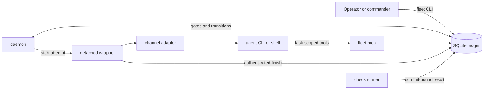
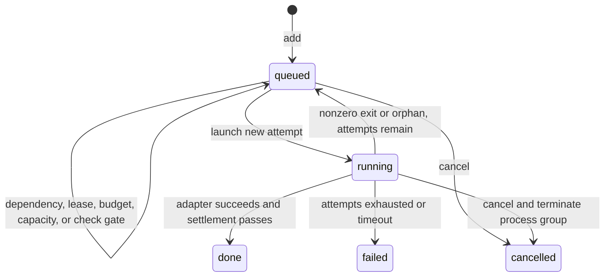
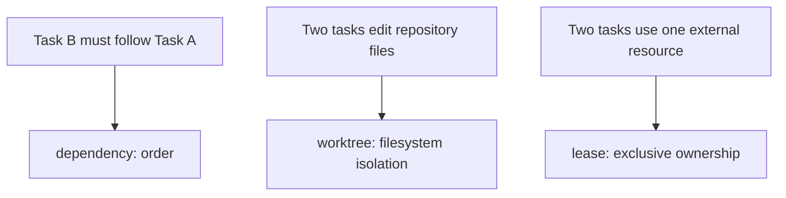

English | [中文](architecture.zh-CN.md)

# Fleet architecture

Fleet separates model judgment from process supervision and durable state. An agent decides how to solve a bounded problem; Fleet records what was requested, starts the process when mechanical gates allow it, and retains evidence after the agent session is gone.

## Process boundaries

The boundaries are intentionally narrow:

- `bin/fleet` is the operator CLI and scheduler implementation. The foreground CLI may enqueue or start work, but it does not have to stay alive for a task to finish.
- The daemon runs the same scheduler repeatedly. It reaps processes, settles timeouts and checks, applies plan rules, considers commander rounds, and launches ready tasks.
- Each launch gets a detached wrapper. The wrapper invokes one adapter, captures diagnostics, and calls Fleet's internal finish path with the attempt identity.
- An adapter translates the common five-argument contract into one agent CLI invocation. Model flags, configuration isolation, MCP wiring, and output handling stop at this boundary.
- `fleet-mcp` exposes a task-scoped control plane. It lets the current attempt read its assignment, use the mailbox, and record claims or artifacts without direct database access.
- The check runner executes operator-owned acceptance commands in a separate worktree and returns an authenticated result.

This split keeps a provider CLI failure from becoming a database protocol, and keeps a terminal or model context from becoming the only scheduler.

## SQLite as the single source of truth

Agent tasks last much longer than a ledger transaction. Fleet therefore needs durable, concurrent reads and short atomic writes, but not a distributed message broker. SQLite in WAL mode fits that shape: monitors and workers can read while one writer records a transition, and the complete control state remains one recoverable local database.

Using separate state files for the queue, messages, and results would introduce ordering questions after a crash: a task could be “done” in one file but still “running” in another. A single transaction can instead settle an attempt, release its lease, append its event, and update the task together.

The main ledger tables have distinct jobs:

| Table | Role |
|---|---|
| `goal` | Durable intent, acceptance, approval gates, context, budget, verification gate, and autonomy policy. |
| `plan` | Versioned DAG/rules and the rationale for each revision. |
| `task` | Requested work, execution identity, dependencies, state, limits, review edge, and worktree baseline. |
| `attempt` | One launch UUID, generation, process identity, run paths, and terminal result. |
| `event` | Append-oriented state and protocol history used for observation and wakeups. |
| `message` | Pull-based mailbox entries with sender, recipient, topic, reply, and read state. |
| `claim` | A conclusion, concrete evidence, attempt identity, and verification outcome. |
| `artifact` | A produced path with kind, summary, size, and content digest. |
| `decision` | A recorded judgment or unresolved choice, optionally requiring the user. |
| `review` | Review lens, reviewer identity, round, verdict, and evidence. |
| `lease` / `budget` | Exclusive resource ownership and per-channel period accounting. |
| `model_probe` | Last observed health for a channel and model. |
| `check_spec` / `check_run` | Versioned check definitions and commit-bound immutable executions. |

These records are not interchangeable prose containers. A message coordinates; it does not prove a conclusion. A claim states the conclusion and points to evidence. An artifact names a file but does not assert that its contents are correct. A decision preserves judgment that cannot be derived from task status. An event says that a transition happened.

Large message or event content may be stored as a content-addressed blob under `$FLEET_HOME/blobs/`, with the ledger row holding the reference. Consumers use Fleet to read it back consistently.

## Task lifecycle

The durable task states are `queued`, `running`, `done`, `failed`, and `cancelled`.

`blocked` is a display and event condition, not a sixth stored state. Keeping the task `queued` means it can become runnable when a dependency finishes, a lease is released, budget changes, or capacity opens.

Every real launch increments the readable attempt number and creates a random `attempt_id`. That UUID is copied into the wrapper and MCP environment. Finish callbacks and worker-side writes must match the current running attempt. If an old process reports after a retry began, Fleet rejects the stale write instead of attaching it to the new execution.

The attempt owns a directory such as `$FLEET_HOME/runs/12/attempt-2/` containing the rendered prompt, final output, log, wrapper metadata, and trace data. Task fields point to the current attempt, while older attempt rows and directories remain available for diagnosis.

## Scheduling, worktrees, and leases

Readiness is computed from durable facts: dependencies, required checks, approval decisions, channel and model concurrency, budgets, leases, probe evidence, timeouts, and retry limits. Scheduling does not depend on an agent remembering which terminal started what.

Three mechanisms solve different kinds of conflict:

A dependency orders work but does not copy changes by itself. `ID:base` or a pinned `base_commit` also selects the content baseline for a downstream worktree. Fleet records the resolved base so `fleet diff` and reviews compare against the same point even if another branch later advances.

A private worktree gives one writer its own index, working directory, and task branch. It prevents two agents from silently overwriting the same files, but it cannot isolate an external server, device, cache, or shared build directory.

A lease covers that second category. Its resource name is arbitrary; while the holder is running, another task requesting the same name remains queued. The lease is acquired and released in ledger transactions so a prompt-level agreement is not the only mutex.

Per-attempt scratch is namespaced by the ledger, task, and attempt under `/var/tmp/fleet`. This prevents equal task IDs from independent ledgers from sharing temporary state.

## Channels, models, and cross-family review

A channel is an execution and accounting route, not a model identity. The effective model comes from the task override or channel default. Fleet validates the offered model list, then applies the ordered `model_families` patterns. It repeats family resolution at launch so an edited runtime registry cannot silently change a queued review's identity.

Cross-family review reduces one common source of correlated error: a model checking its own style of reasoning may repeat the same blind spot. A `review_of` edge therefore rejects a model-backed reviewer in the reviewed task's family. The CLI name is not evidence of family because one CLI can serve several providers or aliases.

This is diversity enforcement, not proof of correctness. A different family can still agree with a wrong result, so reviews must leave claims with concrete evidence. A successful review with no claim is failed because no machine-visible verdict exists.

Remote adapters may run ordinary work, but they cannot certify a review. Fleet can pass a declared model to a remote command, yet the local process cannot prove which model the remote service actually used. Treating that declaration as independent identity would weaken the review invariant.

## Goals and commander control

A goal stores intent and acceptance beyond the lifetime of any task. A versioned plan stores rules together with rationale, so automation has both an executable trigger and a human-readable reason. A new plan revision deliberately re-arms its rules.

Autonomy adds an agent to the control loop without giving it direct scheduler authority. Each commander round is a normal, short-lived channel task. The daemon builds a bounded snapshot of the goal, plan revision, event watermark, tasks, claims, decisions, messages, channels, and constraints. The commander returns candidate tasks and decisions; the daemon revalidates them and applies accepted candidates transactionally.

Generation numbers and watermarks fence this proposal. If the autonomy policy, plan, lease, or observed event set changed while the commander was thinking, an obsolete proposal cannot be applied as though it were current. Round limits, task limits, cooldown, budgets, and unresolved user decisions bound further work.

## Failure and recovery

Fleet treats process disappearance as a state to reconcile, not as proof of success.

- **Adapter exit:** zero proceeds to successful settlement; nonzero retries while `max_attempts` remains, then fails. Diagnostics are kept even when the adapter failed before producing normal output.
- **Timeout:** Fleet terminates the task process group and marks the task failed with its timeout exit code. Timeout is terminal even when the configured attempt count has unused slots.
- **Orphaned wrapper:** if the recorded wrapper vanished without an authenticated finish, the reaper waits for its grace conditions, then requeues or fails using the same attempt limit.
- **Background processes:** an adapter returning while task-owned children remain alive does not settle the task. It remains running and keeps its lease until the children exit or timeout requires intervention.
- **PID reuse:** stored process start time and session identity distinguish the launched wrapper from an unrelated later process with the same numeric PID.
- **Late callbacks:** attempt UUID fencing rejects old finish, claim, artifact, message, and proposal writes after retry or settlement.
- **Daemon restart:** queued and running facts remain in SQLite. A new daemon poll can reap, recover, and continue without reconstructing terminal history.
- **Registry drift:** family changes, unavailable remote nodes, or invalid channel configuration block launch and create visible evidence instead of changing execution silently.
- **Check interruption:** check identities and runner state are durable. The daemon can harvest completed work or classify an interrupted run without trusting an agent summary.

Schema triggers protect append-only check audit rows and guarded verification changes. Fleet checks the live trigger set during initialization and daemon polling. This detects inconsistent same-user modifications, but it does not stop code with the same OS permissions from reading or rewriting local data.

## Deliberate non-goals

Fleet intentionally does not provide:

- automatic task decomposition quality or model judgment;
- automatic commit, merge, push, or deletion of a task's changes;
- an OS security boundary between processes running as the same user;
- cryptographic proof of the model behind a remote endpoint;
- push delivery to workers that are not at an explicit mailbox rendezvous;
- unlimited autonomous work;
- a distributed queue for several mutually untrusted machines.

The result is a local control plane whose state can be reconstructed from the ledger. Intent belongs in goals and plan rationale, execution facts in tasks, attempts, events, and checks, conclusions in claims, files in artifacts, and unresolved judgment in decisions.

See the [Guide](guide.md) for operating procedures and [Adapters](adapters.md) for the process contract.
