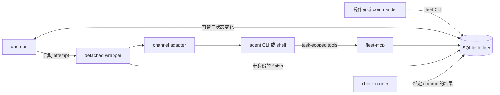
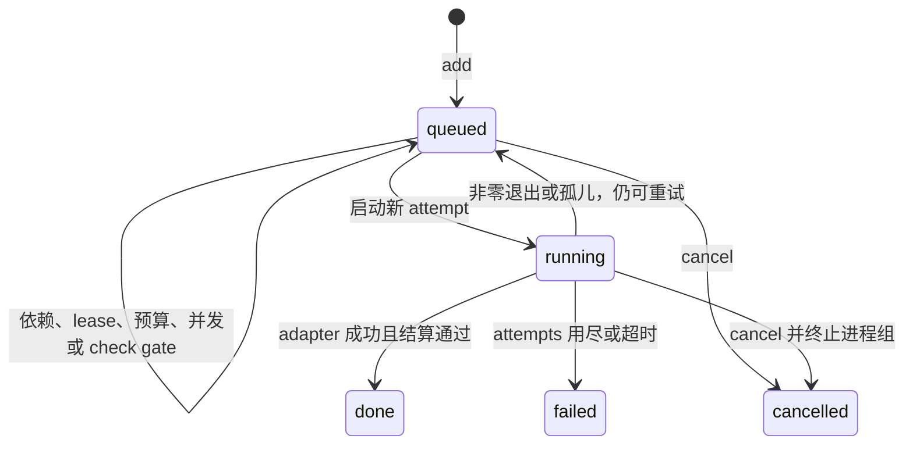
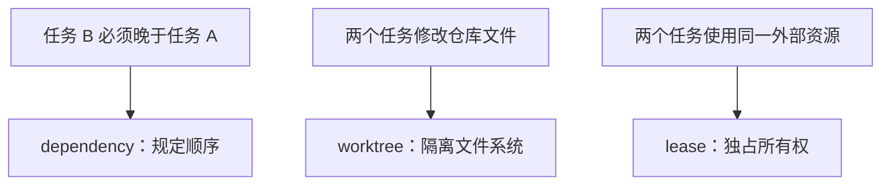

[English](architecture.md) | 中文

# Fleet 架构

Fleet 把模型判断、进程监管和持久状态拆开。Agent 决定怎样解决一个边界明确的问题；Fleet 记录任务要求，在机械门禁允许时启动进程，并在 agent session 消失后继续保存状态与证据。

## 进程边界

每条边界只承担有限职责：

- `bin/fleet` 是操作者 CLI，也是 scheduler 实现。前台 CLI 可以入队或启动任务，但不需要一直存活到任务结束。
- Daemon 反复运行同一套 scheduler：回收进程、处理超时和 checks、应用 plan rules、判断是否启动 commander，并启动就绪任务。
- 每次启动都有一个脱离终端的 wrapper。它调用一个 adapter、收集诊断，并带 attempt 身份进入 Fleet 内部 finish 路径。
- Adapter 把统一的五参数约定翻译为一次 agent CLI 调用。模型参数、配置隔离、MCP 接线与输出处理都收口在这里。
- `fleet-mcp` 是 task-scoped 控制面。当前 attempt 可读取任务、使用 mailbox、登记 claim 与 artifact，无需直接访问数据库。
- Check runner 在另一个 worktree 中运行操作者定义的验收命令，并返回带身份的结果。

这样，供应商 CLI 的失败不会变成数据库协议；某个终端或模型上下文也不会成为唯一 scheduler。

## 为什么用 SQLite 作为单一事实源

Agent 任务通常远长于一次 ledger 事务。Fleet 需要持久化、并发读取和短时间原子写入，但不需要分布式 message broker。SQLite WAL 符合这个形状：monitor 和 worker 可同时读取，一个 writer 记录状态变化，完整控制状态仍在一个可恢复的本机数据库里。

如果队列、消息和结果分别存放，崩溃恢复时就会遇到顺序问题：一个文件认为任务已完成，另一个仍写着 running。单一事务可以同时结束 attempt、释放 lease、追加 event 并更新 task。

主要 ledger 表各自有明确用途：

| 表 | 作用 |
|---|---|
| `goal` | 持久意图、验收、审批 gate、context、预算、验证 gate 与 autonomy policy。 |
| `plan` | 带版本的 DAG/rules，以及每个 revision 的 rationale。 |
| `task` | 工作要求、执行身份、依赖、状态、限制、review 关系与 worktree 基线。 |
| `attempt` | 一次启动的 UUID、代数、进程身份、运行路径和终态结果。 |
| `event` | 追加式状态与协议历史，供观察和唤醒使用。 |
| `message` | pull 模式 mailbox，包含发送者、接收者、topic、reply 与已读状态。 |
| `claim` | 结论、具体证据、attempt 身份和验真结果。 |
| `artifact` | 交付路径，以及 kind、summary、大小和内容摘要。 |
| `decision` | 已记录的判断或尚未解决的选择，可要求用户处理。 |
| `review` | Review lens、reviewer 身份、轮次、verdict 与证据。 |
| `lease` / `budget` | 独占资源所有权与渠道周期用量。 |
| `model_probe` | 渠道与模型最近一次探活结果。 |
| `check_spec` / `check_run` | 带版本的检查定义与绑定 commit 的不可改写执行记录。 |

这些记录不能互相替代。Message 用来协调，但不能证明结论；claim 陈述结论并指向证据；artifact 指向文件，却不表示文件内容一定正确；decision 保存无法从 task 状态推导的判断；event 说明某次状态变化发生过。

过大的 message 或 event 内容可以写入 `$FLEET_HOME/blobs/` 下的 content-addressed blob，ledger row 保留引用。读取仍经过 Fleet，以便一致地还原内容。

## 任务生命周期

持久任务状态只有 `queued`、`running`、`done`、`failed` 和 `cancelled`。

`blocked` 是界面和 event 中的条件，不是第六种持久状态。任务保持 `queued`，才能在依赖完成、lease 释放、预算变化或并发空出后重新变为可运行。

每次真实启动都会增加易读的 attempt 序号，并生成随机 `attempt_id`。UUID 会进入 wrapper 与 MCP 环境。Finish callback 和 worker 写操作必须匹配当前 running attempt。旧进程若在重试后才回报，Fleet 会拒绝这条 stale write，而不是把它挂到新执行上。

Attempt 拥有类似 `$FLEET_HOME/runs/12/attempt-2/` 的目录，其中保存渲染后的 prompt、最终输出、日志、wrapper 元数据和 trace。Task 字段指向当前 attempt，旧 attempt row 和目录仍可用于诊断。

## 调度、worktree 与 lease

是否就绪由持久事实决定：依赖、required checks、审批 decision、渠道与模型并发、预算、lease、探活证据、超时和重试限制。Scheduler 不依赖某个 agent 记得任务从哪个终端启动。

三种机制解决三类冲突：

依赖只规定顺序，不会自动复制上游改动。`ID:base` 或钉死的 `base_commit` 还会选择下游 worktree 的内容基线。Fleet 保存解析后的 base，让 `fleet diff` 与 review 始终对比同一点，即使其他分支后来继续前进。

私有 worktree 给一个 writer 独立的 index、工作目录和任务分支，避免两个 agent 静默覆盖同一文件；但它隔离不了外部服务、设备、cache 或共享 build 目录。

Lease 覆盖后一类资源。资源名由用户定义；holder 运行期间，申请同名 lease 的其他任务保持 queued。Lease 的获取和释放都在 ledger 事务里完成，不把 prompt 中的口头约定当作唯一互斥锁。

每个 attempt 的 scratch 在 `/var/tmp/fleet` 下按 ledger、task 和 attempt 分区，避免独立 ledger 中相同 task ID 共用临时状态。

## 渠道、模型与跨族 review

Channel 是执行和计费路径，不是模型身份。生效模型来自任务 override 或渠道默认值。Fleet 先检查 offered model 列表，再按有序 `model_families` 归类；启动时会再次解析，避免运行时渠道表被编辑后悄悄改变已排队 review 的身份。

跨族 review 用来减少一种常见的相关性错误：同一模型检查自己的推理方式时，可能重复同一盲点。因此，`review_of` 会拒绝与被审任务同模型族的 model-backed reviewer。CLI 名称不能充当模型族证据，因为一个 CLI 可以连接多个供应商或别名。

这只是强制多样性，不是正确性证明。不同模型族仍可能一起判断错误，所以 review 必须留下带具体证据的 claim。成功退出却没有 claim 的 review 会被判失败，因为 ledger 里没有机器可见的结论。

远端 adapter 可以执行普通任务，但不能担任 reviewer。Fleet 能把声明的模型传给远端命令，却无法从本机证明远端服务最终用了哪个模型。把声明当作独立身份会削弱 review 不变量。

## Goal 与 commander 控制

Goal 保存跨 task 生命周期的意图与验收。带版本 plan 同时保存 rules 和 rationale，让自动化既有可执行 trigger，也保留人能理解的原因。发布新 plan revision 会有意重新武装 rules。

Autonomy 可以把 agent 放进控制循环，但不会给它 scheduler 的直接权限。每轮 commander 都是普通的短生命周期渠道任务。Daemon 生成有大小上限的快照，包含 goal、plan revision、event watermark、tasks、claims、decisions、messages、channels 和响应约束。Commander 返回候选任务与 decision；daemon 重新验证，并在事务中写入合格候选。

Generation 与 watermark 为提案设置 fence。如果 commander 思考期间 autonomy policy、plan、lease 或已观察 event 集合发生变化，过时提案不能假装仍是当前结果。轮数、每轮任务数、cooldown、预算和未处理用户 decision 共同限制后续工作。

## 失败与恢复

进程消失是需要对账的状态，不是成功证据。

- **Adapter 退出：** 零退出进入成功结算；非零退出在 `max_attempts` 仍有余量时重试，否则 failed。即使 adapter 在正常输出前失败，诊断也会保留。
- **超时：** Fleet 终止任务进程组，并用 timeout exit code 把任务标为 failed。即使配置的 attempt 次数仍有余量，timeout 也是终态。
- **Wrapper 孤儿：** 已登记 wrapper 未执行带身份的 finish 就消失时，reaper 等待宽限条件，然后按同一 attempt 上限 requeue 或 fail。
- **后台进程：** Adapter 返回时若仍有任务子进程存活，任务不会结算；它保持 running 并继续持有 lease，直到子进程退出或 timeout 介入。
- **PID 复用：** 记录的进程启动时间与 session 身份可区分真实 wrapper 和后来拿到同一数字 PID 的无关进程。
- **迟到回调：** Attempt UUID fence 会拒绝重试或结算后的旧 finish、claim、artifact、message 和 proposal 写入。
- **Daemon 重启：** queued 和 running 事实仍在 SQLite 中；新 daemon poll 可以回收、恢复并继续，不必重建终端历史。
- **渠道表漂移：** 模型族变化、远端节点不可用或渠道配置无效时阻止启动并写出可见证据，不静默换执行身份。
- **Check 中断：** Check 身份和 runner 状态持久化；daemon 可收割已完成结果，或分类中断运行，不依赖 agent 自述。

Schema trigger 保护追加式 check 审计行和受控验证开关。`fleet init` 与 daemon poll 会比较实际 trigger 集合。它可以发现同一用户下不一致的修改，却不能阻止拥有同一系统权限的代码读取或重写本机数据。

## 刻意不做的事

Fleet 有意不提供：

- 自动产生高质量任务拆分或模型判断；
- 自动 commit、merge、push 或删除任务改动；
- 同一用户进程之间的操作系统安全边界；
- 远端端点背后模型身份的密码学证明；
- 向不在明确 mailbox 会合点的 worker 推送消息；
- 无上限自治；
- 面向多台互不信任机器的分布式队列。

最终得到的是一个可从 ledger 重建状态的本机控制面：意图属于 goal 与 plan rationale，执行事实属于 task、attempt、event 与 check，结论属于 claim，文件属于 artifact，未解决的人类判断属于 decision。

操作步骤见[使用指南](guide.zh-CN.md)，进程调用约定见[适配器文档](adapters.zh-CN.md)。
